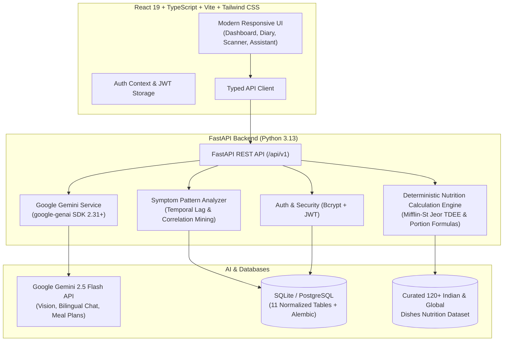

# SehatSense AI — Smart Food Choices, Better Health.
> **Tagline:** Smart Food Choices, Better Health.  

[]()
[]()
[]()
[]()
[]()
[]()

SehatSense AI is a modern, responsive, full-stack wellness intelligence platform tailored for Indian and global food cultures. Powered by the **official Google Gen AI SDK (`google-genai`)** and deterministic nutrition science, SehatSense AI empowers individuals to understand daily meals, track hydration and activity, plan affordable menus, and discover evidence-based correlations between foods and self-reported symptoms.

---

## 🏗️ Architecture



---

## ✨ Key Features

1. **AI Food Photo Recognition (Gemini Vision)**
   - Upload photos of rotis, dals, sabzis, thalis, or snacks.
   - Multimodal Gemini image interpretation returns detected dishes and portion estimates for user confirmation.
   - Seamless manual-entry fallback with autocomplete search across 120+ authentic Indian items.

2. **Deterministic Indian & Global Nutrition Engine**
   - High-fidelity nutrition values (Calories, Protein, Carbs, Healthy Fat, Dietary Fiber, Sugars, Sodium) per 100g.
   - Standard Indian units: *katori*, *roti*, *bowl*, *plate*, *glass*, and *grams*.
   - Portion formula: `estimated_nutrient = (nutrient_per_100g * portion_grams) / 100`.
   - Personalized targets calculated using the clinical Mifflin-St Jeor equation and ICMR macronutrient distribution guidelines.

3. **Food-to-Symptom Pattern Analyzer ("Food & Symptom Insights")**
   - Mined from actual logged food entries and user-reported digestive symptoms (bloating, acidity, indigestion, nausea).
   - Computes onset time lag (30 min to 6 hours) and co-occurrence frequency.
   - Uses Gemini to explain verified observations in supportive language with clear medical disclaimers.
   - Includes user feedback mechanism (*Helpful*, *Inaccurate*, *Not Relevant*).

4. **Bilingual Hindi-English AI Assistant**
   - Conversational assistant supporting English, Hindi (हिन्दी), and Hinglish.
   - Injects the authenticated user's real-time diary context (today's calories, protein, water, symptoms) with zero fabricated history.
   - Adheres strictly to wellness education guardrails.

5. **Smart AI Meal Planner & Grocery List**
   - Creates personalized daily/weekly meal plans adhering to dietary preferences (Vegetarian, Eggetarian, Vegan, Non-Veg, Jain), food allergies, and daily budget (e.g. ₹250/day).
   - **1-Click Add to Food Diary**: Logs the planned menu directly into the diary.
   - **Automated Grocery List**: Extracts and categorizes ingredients into Produce, Dairy/Protein, Grains/Pulses, Spices, and Pantry aisles.

6. **"Eat This, Try This" Alternative Engine**
   - Practical upgrades without cultural food-shaming: protein boosters, seasonal fruit swaps, and digestive aids.

7. **Exercise & Digestion Support**
   - Traditional 100-step post-meal digestion strolls (*Shatapawali*), walking, yoga, and strength routines.
   - Real-time MET (Metabolic Equivalent of Task) calorie burn calculation.

8. **Hydration Tracker**
   - Daily progress ring, quick-tap volume presets (+250ml, +500ml, +750ml, +1L), and configurable targets.

9. **Privacy & Account Controls**
   - Transparent health data and AI processing consent toggles.
   - One-click permanent account and record deletion (*Right to be Forgotten*).

---

## 🚀 Quick Start Guide

### Prerequisites
- **Node.js**: v18+ (tested on v24)
- **Python**: 3.11+ (tested on 3.13)
- **Git**

### 1. Clone & Setup Workspace
```bash
git clone https://github.com/vikash0885/nutriai-health-assistant.git sehatsense-ai
cd sehatsense-ai
```

### 2. Backend Setup
```bash
# Navigate to backend
cd backend

# Create and activate virtual environment
python -m venv venv

# Windows:
.\venv\Scripts\activate
# macOS/Linux:
source venv/bin/activate

# Install dependencies
pip install -r requirements.txt

# Configure environment variables
copy .env.example .env    # On Windows
# cp .env.example .env    # On macOS/Linux

# Apply database migrations
alembic upgrade head

# Run automated tests to verify
pytest

# Start the FastAPI backend
uvicorn app.main:app --reload --port 8000
```
Backend API will be accessible at `http://localhost:8000`.
Interactive OpenAPI docs are available at `http://localhost:8000/docs`.

### 3. Frontend Setup
In a new terminal window:
```bash
cd frontend

# Install npm dependencies
npm install

# Start Vite development server
npm run dev
```
Frontend will be live at `http://localhost:5173`.

---

## 🔑 Google Gemini API Configuration

1. Visit [Google AI Studio](https://aistudio.google.com/) and generate a free API key.
2. Open `backend/.env` and insert your key:
   ```env
   GEMINI_API_KEY="your_actual_gemini_api_key_here"
   GEMINI_MODEL="gemini-2.5-flash"
   ```
3. Restart the backend server.
> **Offline Fallback Note:** If no Gemini API key is configured, SehatSense AI gracefully runs in offline fallback mode with manual food logging, portion calculations, deterministic symptom pattern detection, and local meal plan templates.

---

## 🐳 Docker Deployment

Run the complete multi-container stack with a single command:
```bash
docker compose up --build
```
- Frontend: `http://localhost:5173`
- Backend API: `http://localhost:8000`

---

## 🧪 Testing

The backend includes a comprehensive pytest suite covering:
- Authentication & JWT token security
- Safe calorie and macronutrient calculations (Mifflin-St Jeor)
- Curated food database search and portion scaling
- Deterministic symptom-pattern detection with temporal lags
- End-to-end API flows (food, water, exercise, dashboard)

To run the test suite:
```bash
cd backend
.\venv\Scripts\pytest -v
```

---

## 🛡️ Medical Safety & Disclaimer

SehatSense AI is an educational wellness and lifestyle tracking assistant.
- **Not Medical Advice:** SehatSense AI does not diagnose, treat, or cure medical conditions.
- **Correlations, Not Causation:** Observed diary associations between foods and symptoms reflect personal logs and do not constitute clinical allergy or intolerance diagnoses.
- **Medical Evaluation:** For persistent, severe, or worsening symptoms (e.g., severe abdominal pain, persistent nausea), users should promptly consult a licensed healthcare professional.

---

## 📄 License
Released under the MIT License. Built with ❤️ for balanced living across Indian & global food cultures.
